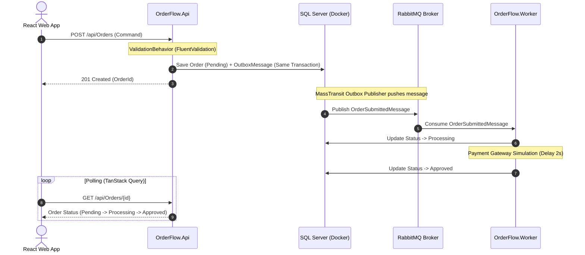

# 📦 OrderFlow - Enterprise Order Processing & Messaging Platform

[](https://github.com/FelipeCJSEP/OrderFlow/actions/workflows/ci.yml)


A production-ready asynchronous order processing platform built to demonstrate **Senior-Level Clean Architecture**, **Domain-Driven Design (DDD)**, **Reliable Messaging with Transactional Outbox Pattern**, **Automated Testing with Testcontainers**, and **CI/CD via GitHub Actions**.

---

## 🏛️ Architecture Overview

The system is designed following **Clean Architecture** and **Ports & Adapters (Hexagonal)** principles:

```
OrderFlow/
├── src/
│   ├── OrderFlow.Domain/            # Pure C# (Entities, Value Objects, Domain Events, Repositories Contracts)
│   ├── OrderFlow.Application/       # CQRS (MediatR), Pipeline Behaviors, FluentValidation
│   ├── OrderFlow.Infrastructure/    # EF Core, SQL Server Mappings (Fluent API), Outbox, Repositories
│   ├── OrderFlow.Api/               # ASP.NET Core Web API, Minimal/Controllers, RFC 7807 ProblemDetails
│   └── OrderFlow.Worker/            # Background Worker Service, MassTransit Consumers, Retry Policies
│
├── orderflow-web/                   # Frontend SPA (React + TypeScript + Vite + Tailwind CSS + TanStack Query)
│
├── tests/
│   ├── OrderFlow.UnitTests/         # Fast in-memory tests (xUnit + FluentAssertions)
│   └── OrderFlow.IntegrationTests/  # End-to-end tests with real SQL Server via Testcontainers
│
├── .github/workflows/
│   └── ci.yml                       # Automated CI pipeline running builds and Testcontainers in cloud
└── docker-compose.yml               # Local infrastructure (SQL Server 2022 + RabbitMQ Management)
```

---

## ⚡ Asynchronous Lifecycle & Outbox Pattern



---

## 🌟 Key Senior Architectural Highlights

### 1. Pure & Rich Domain Model
- **Zero Third-Party Dependencies:** `OrderFlow.Domain` contains only pure C# primitives.
- **Encapsulation & Defensive Programming:** All setters are private/init. Collections are exposed via `IReadOnlyCollection<T>`. Invariants are protected through factory methods (`Order.Create`) and state machine transitions (`MarkAsProcessing`, `MarkAsApproved`, `MarkAsFailed`).
- **Domain Events:** Emits `OrderCreatedDomainEvent`, `OrderApprovedDomainEvent`, and `OrderFailedDomainEvent`.

### 2. CQRS & Pipeline Behaviors (MediatR)
- Separation between **Commands** (state modifications) and **Queries** (reads).
- **Automatic Validation Pipeline:** Generic `ValidationBehavior<TRequest, TResponse>` intercepts all commands and automatically executes FluentValidation rules before handlers are invoked.
- **RFC 7807 ProblemDetails:** Centralized `IExceptionHandler` (`GlobalExceptionHandler`) standardizes HTTP 400 Bad Request responses with detailed property-level validation errors.

### 3. Transactional Outbox Pattern (MassTransit + EF Core)
- Avoids the **Dual-Write Problem**: Orders and event messages are committed within the **exact same SQL transaction**.
- Guaranteed **At-Least-Once Delivery**: Even if RabbitMQ goes offline, messages persist safely in `OutboxMessage` and are dispatched as soon as the broker recovers.

### 4. Resilient Worker & Dead Letter Queue (DLQ)
- Worker configured with **Exponential Backoff & Retries** (`UseMessageRetry`).
- Messages that exceed maximum retry attempts are automatically routed to a Dead Letter Queue (`order-submitted-queue_error`) for diagnosis.

### 5. Automated Testing with Testcontainers
- **Unit Tests:** 10 fast unit tests verifying domain invariants, state transitions, and validation rules.
- **Integration Tests:** 3 real end-to-end integration tests using **`Testcontainers.MsSql`** to spin up dynamic, ephemeral SQL Server 2022 containers in Docker, run EF Core migrations, and assert physical database persistence.

### 6. Modern Frontend (React + TypeScript)
- Built with **React 18/19**, **TypeScript**, and **Tailwind CSS**.
- **TanStack Query (React Query):** Implements dynamic auto-polling (`refetchInterval`) that seamlessly transitions the UI status badge from `Pending` -> `Processing` -> `Approved` in real time as the background worker finishes processing.

---

## 🚀 Getting Started

### Prerequisites
- [.NET 8 SDK](https://dotnet.microsoft.com/download/dotnet/8.0)
- [Docker Desktop](https://www.docker.com/products/docker-desktop/) (running WSL2 or Hyper-V)
- [Node.js](https://nodejs.org/) (v20+ LTS)

### 1. Clone & Spin up Infrastructure
```bash
git clone https://github.com/FelipeCJSEP/OrderFlow.git
cd OrderFlow

# Start SQL Server and RabbitMQ
docker compose up -d
```

> **RabbitMQ Management UI:** Accessible at [http://localhost:15672](http://localhost:15672) (User: `guest` | Pass: `guest`).

### 2. Run Database Migrations
```bash
dotnet ef database update --project src/OrderFlow.Infrastructure --startup-project src/OrderFlow.Api
```

### 3. Run Backend (API & Worker)
In Visual Studio, configure **Multiple Startup Projects** to run both:
- `OrderFlow.Api` (`https://localhost:7000`)
- `OrderFlow.Worker` (Console Background Service)

Or run via CLI in separate terminals:
```bash
# Terminal 1: API
dotnet run --project src/OrderFlow.Api

# Terminal 2: Worker
dotnet run --project src/OrderFlow.Worker
```

> **Swagger UI:** Accessible at [https://localhost:7000/swagger](https://localhost:7000/swagger).

### 4. Run Frontend (React SPA)
```bash
cd orderflow-web
npm install --legacy-peer-deps
npm run dev
```

> **Web Dashboard:** Open [http://localhost:5173](http://localhost:5173).

---

## 🧪 Running Tests

```bash
# Run all unit and integration tests (Docker must be running for Testcontainers)
dotnet test
```

---

## 🛠️ Tech Stack

| Category | Technology |
| :--- | :--- |
| **Backend Framework** | .NET 8 (C# 12) |
| **Architecture** | Clean Architecture, DDD, CQRS |
| **Orchestration / MediatR** | MediatR 12.x |
| **Validation** | FluentValidation 11.x |
| **ORM & Database** | Entity Framework Core 8.x + SQL Server 2022 |
| **Messaging & Outbox** | RabbitMQ + MassTransit 8.x (Transactional Outbox) |
| **Testing** | xUnit, FluentAssertions, Testcontainers, WebApplicationFactory |
| **Frontend Framework** | React 18/19 + TypeScript + Vite |
| **Styling & Icons** | Tailwind CSS + Lucide React |
| **Data Fetching** | TanStack Query (React Query) + Axios |
| **CI/CD** | GitHub Actions |

---

## 📄 License
This project is licensed under the MIT License.
